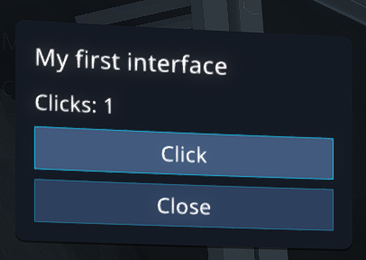

# Your First Module Interface

[Creating Interfaces](../3.UI.md) · Chapter 1 of 4 · [Next: UXML Layout](./2.UXML.md)

Let's build a small panel with a click counter and a close button. It needs three files: UXML describes the elements, USS defines their appearance, and Lua handles clicks.

## 1. Prepare the Module

Create a regular module without Reflex by following the [beginner's guide](../2.Start.md#2-first-module). Keep the `module.json` created by the game and arrange the example files as follows:

```text
My First Interface/
├── module.json
├── scripts/
│   └── main.lua
└── ui/
    ├── Counter.uxml
    └── counter.uss
```

## 2. Add the Layout

Contents of `ui/Counter.uxml`:

```xml
<ui:UXML xmlns:ui="UnityEngine.UIElements">
    <Style src="./counter.uss" />
    <ui:VisualElement name="Root" class="counter-panel">
        <ui:Label text="My first interface" class="counter-title" />
        <ui:Label name="CountLabel" text="Clicks: 0" />
        <ui:Button name="CountButton" text="Click" class="counter-button" />
        <ui:Button name="CloseButton" text="Close" class="counter-button" />
    </ui:VisualElement>
</ui:UXML>
```

A UXML document must contain one root visual element. `Style` connects a style sheet and does not create an on-screen element. `name` lets Lua find an element, while `class` connects it to USS rules. Text is specified with the `text` attribute, not between opening and closing tags.

## 3. Add Styles

Contents of `ui/counter.uss`:

```css
.counter-panel {
    position: absolute;
    left: 40px;
    top: 140px;
    width: 280px;
    padding: 16px;
    background-color: rgb(20, 26, 36);
    border-radius: 8px;
    color: rgb(240, 240, 240);
    font-size: 16px;
}

.counter-title {
    font-size: 20px;
    margin-bottom: 12px;
}

.counter-button {
    height: 36px;
    margin-top: 8px;
    background-color: rgb(45, 65, 95);
    color: rgb(255, 255, 255);
}

.counter-button:hover {
    background-color: rgb(65, 90, 125);
}
```

This produces a dark panel in the upper-left corner with a title, a counter, and two vertically stacked buttons. `position: absolute` positions the panel using `left` and `top`. Dimensions use UI units, so the final on-screen size depends on the interface scale. `.counter-button` styles both buttons, while `:hover` changes their background when the pointer is over them.

## 4. Connect Lua

Replace the contents of `scripts/main.lua` with:

```lua
local root = UI:BuildFromUxmlInteractive("Counter.uxml")
if not root then
    print("Could not create the interface. Check the console for UXML errors.")
    return
end

local countLabel = root:GetChild("CountLabel")
local countButton = root:GetChild("CountButton")
local closeButton = root:GetChild("CloseButton")
if not countLabel or not countButton or not closeButton then
    print("Interface elements were not found. Check their name attributes.")
    root:Delete()
    return
end

local count = 0

countButton:OnClick(function()
    count = count + 1
    countLabel.text = "Clicks: " .. count
end)

closeButton:OnClick(function()
    UI:CloseWindow(root)
end)

if not UI:OpenWindow(root, true, true, false, false) then
    print("Could not open the window.")
    root:Delete()
end
```

`BuildFromUxmlInteractive` creates the element and adds it to the screen with mouse input enabled. Its argument is the name of a file in `ui`, without the `ui/` prefix.

`GetChild` searches descendants by `name`, including nested elements, and returns `nil` if no match is found. `OnClick` assigns a click handler.

`OpenWindow(root, true, true, false, false)` opens the window, unlocks the cursor, and blocks game input. The final two `false` values disable hiding obscured UI and blurring the background. `CloseWindow` hides the panel and releases its cursor and input-block requests. Other open windows may continue to hold the cursor.

Create the panel once, as shown here, rather than on every frame. For a regular HUD without buttons, you can use `BuildFromUxmlAbsolute` without opening a window or blocking input. Other creation methods are listed in the [main guide](../3.UI.md#2-ui-toolkit-principles).

## 5. Test It in the Game



1. Enable the module and load a custom-server map. Module Lua code does not run in the main menu.
2. Press the **Click** button several times. The counter should increase.
3. Press **Close**. The panel should disappear and control should return to the game unless another window is holding the input.
4. Change `width: 280px` to `width: 340px` and save the USS file. Changing a file in a local folder-based module causes it to reload. The panel will be recreated and the counter will return to zero. If automatic reload does not work, disable and re-enable the module.

| Problem | What to check |
|---|---|
| The panel does not appear | The module is enabled, a map is loaded, the files are in `ui`, and the console contains no Lua or UXML errors. |
| The buttons do not respond | Interactive creation is used, `OpenWindow` was called, and another window is not covering the panel. |
| An element is not found | The spelling and capitalization of `name` match the argument passed to `GetChild`. |
| A style is not applied | `Style src` matches the USS filename, and the class is present in both UXML and USS. |

The labels are written directly in the code to keep this example short. For a published module, move them to `localization.csv`; the [round statistics chapter](./4.RoundStats.md) contains a `LocalizedLabel` example.

Next: [UXML support](./2.UXML.md), [USS support](./3.USS.md), and the [UI API reference](../../../api/UI.md).
