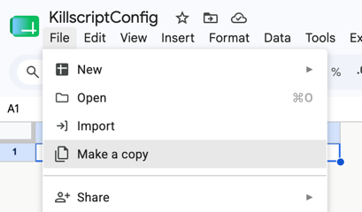
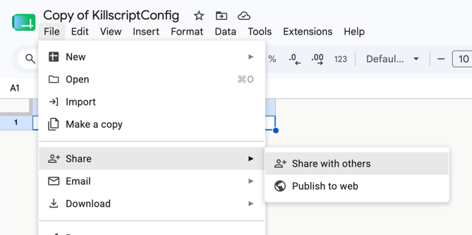
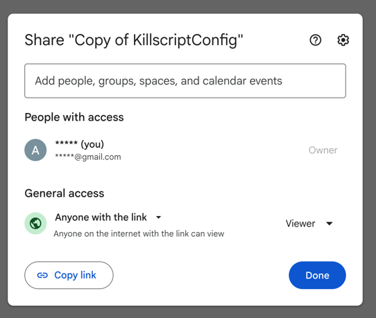

# Creating a Custom Server
A custom server can be created from the game's main menu in just a few clicks. After creating it, you can copy an invitation code from the Esc menu that your friends can use to join.

# Custom Server Management Commands
The custom server creator has access to a set of server management commands. Enter commands in the console, which opens with the `~` key.

1. `start` Starts the match from warmup.
2. `restart` Reloads the map. Resets statistics and the economy, then switches to warmup mode.
3. `load-map <map_name>` Switches the server to a map using its technical name. Use `map-list` to see the available maps.
4. `map-list` Lists the available maps, including debug maps and maps still in development.
5. `reload` Reloads the server configuration from the Google spreadsheet whose link was specified when the server was created.
6. `kill-team <team_id>` Kills all agents on the specified team (1 or 2).

The custom server creator also has access to commands for managing players and agents. Players are users connected to the server. Agents are entities in the game world that players can control.
1. `list-agents` Lists agent IDs and names for use with other commands that accept agent IDs.
2. `kill [agent_id]` Kills the agent with the optional ID, or your own agent if no argument is provided. Example: `kill 3`
3. `heal [agent_id]` Heals the agent with the optional ID, or your own agent if no argument is provided. Example: `heal 3`
4. `list-players` Lists the IDs and names of connected players for use with other commands that accept player IDs.
5. `kick <player_id>` Disconnects a player from the server.

Some commands are available to all players on a custom server.
1. `spectate` Switches between participating in the match and spectator mode.
2. `change-team` Moves you to the opposing team.
3. `change-agent <number>` Moves the player into an available agent on their team, numbered from 1 to 5.

# Changing the Server Configuration
Most game parameters can be changed with a custom server configuration, including:
1. The balance of weapons and other items
2. Global constants such as movement speed or round phase duration
3. Flags that change how game mechanics work. For example, you can enable Wallhack or Air strafe

To do this, make a copy of the [Google spreadsheet containing the game configuration](https://docs.google.com/spreadsheets/d/1QH6T_4mY36d7DIXa6bkYwsSAkzthw3pqnn7ogqMLuC0/edit?usp=sharing).

Then make the spreadsheet accessible to anyone with the link.

You can now edit the game configuration freely.
Parameter descriptions are available in the [Lua documentation](../../api/GameConfig.md). You can paste the spreadsheet link when creating a custom server.
