# Старт с модулями

В этом разделе собраны первые шаги: подготовка окружения, создание первого собственного модуля с его отладкой и клонирование встроенного модуля.

## Оглавление

1. [Подготовка окружения](#1-подготовка-окружения)
2. [Создаем и дебажим первый модуль](#2-создаем-и-дебажим-первый-модуль)
3. [Редактируем встроенный модуль](#3-редактируем-встроенный-модуль)

---

## 1. Подготовка окружения

### 1.1. Что понадобится

Для написания кода модулей понадобится текстовый редактор. Лучше всего подойдет VS Code, так как в нем есть удобное расширение для работы с модульной документацией.

### 1.2. Где лежат модули

Все стандартные модули хранятся в ресурсах игры. Удалять их не рекомендуется, но можно отключить.

Все пользовательские модули лежат в папке Modules в корневой директории игры.

Вся .lua-документация по модулям хранится в папке ModuleAPI в корневой директории игры.

### 1.3. Настройка VS Code

#### Шаг 1. Загрузка VS Code

Скачать VS Code можно по ссылке: [code.visualstudio.com](https://code.visualstudio.com/)

#### Шаг 2. Загрузка расширения для работы с Lua

Скачать расширение для работы с Lua можно здесь: [marketplace.visualstudio.com/sumneko.lua](https://marketplace.visualstudio.com/items?itemName=sumneko.lua)

---

## 2. Создаем и дебажим первый модуль

### 2.1. Что мы сделаем

Теперь пора создать свой первый модуль, но вместо сложной механики сразу разберем самый полезный навык для старта: как быстро проверить, что модуль вообще загрузился, как он перезапускается и где смотреть его логи.

Сделаем простой модуль `Hello Debug`, на котором сразу научимся:

- создавать модуль через GUI игры
- находить папку модуля и понимать, какие файлы создает игра
- запускать модуль на пользовательском сервере
- пользоваться автоперезагрузкой при изменении файлов
- смотреть сообщения из `print()` во внутриигровой консоли
- выводить отладочную информацию на экран текстом

### 2.2. Создаем модуль через меню

Создать модуль можно через кнопку "**Create**" в меню модулей.

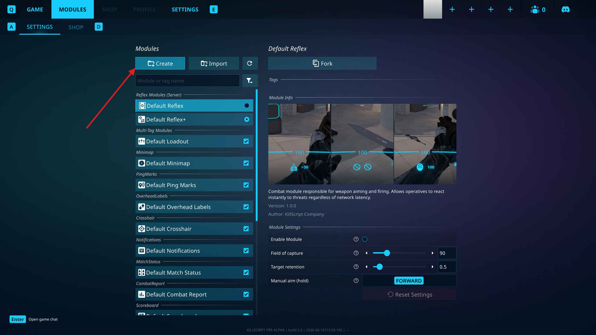

В качестве первого примера удобно назвать модуль `Hello Debug`.

Флаг "**Is Reflex**" создает модуль с серверной частью. Для первого модуля он не нужен. Подробнее: [Tech.md / Флаг Reflex](./5.Tech.md#reflex-flag)

Также мы не добавляем никаких тегов к модулю. Подробнее про теги: [Tech.md / Теги модуля](./5.Tech.md#module-tags)

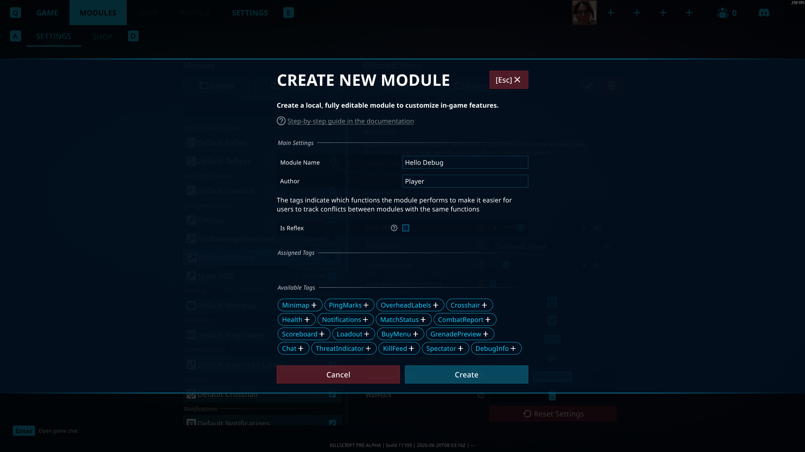

### 2.3. Где лежит модуль и что создает игра

После создания модуль появится в папке:

```text
/[Папка с игрой]/Modules/Hello Debug/
```

Открыть эту папку из игры можно через кнопку "**Folder**".

Внутри уже будут `module.json`, `scripts/main.lua` и служебные файлы для VS Code. Подробнее про структуру: [Tech.md / Структура папки модуля](./5.Tech.md#module-folder-structure)

По умолчанию в `scripts/main.lua` уже лежит самый простой код:

```lua
print("Hello world!")
```

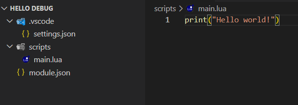

### 2.4. Как тестировать модуль на пользовательском сервере

Для отладки модулей удобнее всего использовать пользовательский сервер из главного меню игры. На нем проще быстро зайти на карту, перезапустить раунд и проверить изменения без матчмейкинга.

Важно: модули не выполняются в главном меню. В нем можно только открыть меню модулей, включить нужный модуль и запустить сервер, а сам Lua-код начнет работать только после загрузки в игру.

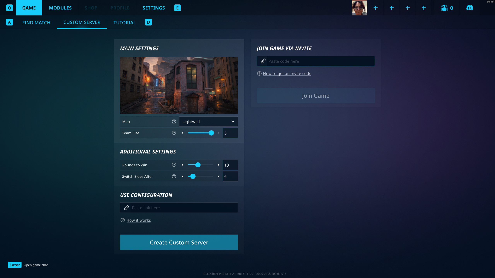

Если нужен отдельный гайд не только по запуску, но и по администрированию пользовательского сервера, можно использовать эту инструкцию:

- [Гайд по администрированию пользовательского сервера](https://www.youtube.com/watch?v=6hbD3Ekx0AE)

### 2.5. Как открыть консоль и найти логи модуля

По умолчанию консоль открывается по клавише тильда `` ` ``. Если у вас она не срабатывает, проверьте настройки игры: клавиша открытия консоли может быть изменена. 

После открытия консоли в строке поиска консоли введите название модуля, например `Hello Debug`. Тогда вы быстро увидите все сообщения, связанные именно с этим модулем: ваши `print()`, ошибки Lua и т.д.

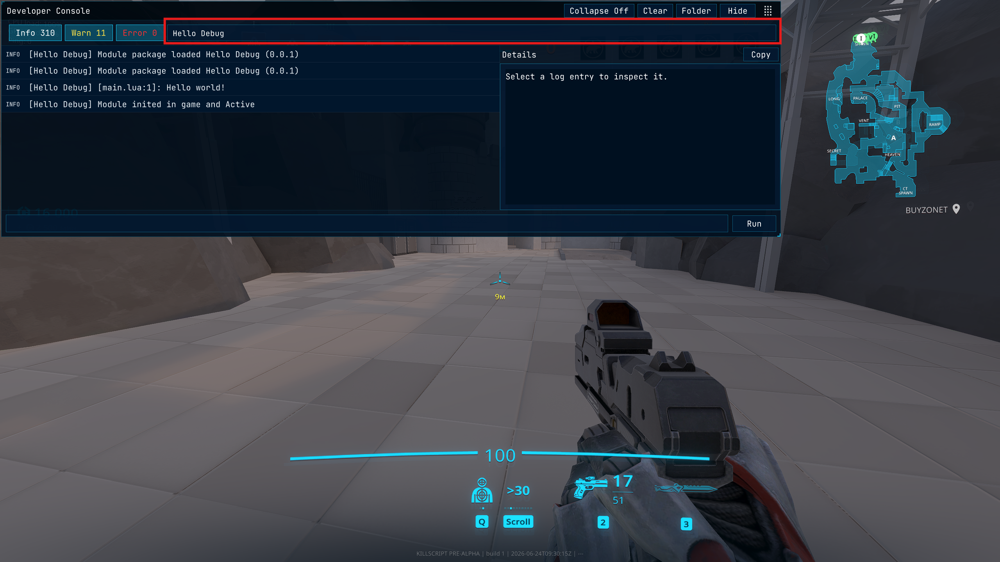

### 2.6. Пишем первый лог

Откройте папку модуля и замените содержимое `scripts/main.lua` на такой пример:

```lua
local first_tick = false

print("main.lua loaded")

local function Tick()
    if first_tick then
        return
    end

    print("First tick")
    first_tick = true
end

Events:On("Tick", Tick)
```

Игра следит за файлами внутри папки модуля. Когда вы сохраняете изменения, модуль **автоматически выполняет перезагрузку**.

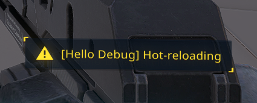

Что делает код:

- первый `print()` срабатывает в момент загрузки файла `main.lua`
- второй `print()` срабатывает в первый кадр после запуска модуля (событие `Tick` вызывается один раз в начале каждого кадра)

Метод `print()` выводит сообщение во внутриигровую консоль. Это самый простой способ понять, выполняется ли нужный участок кода.

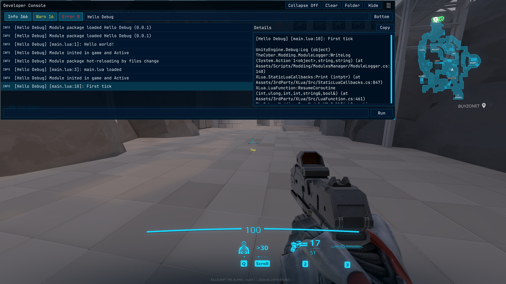

### 2.7. Отладка через ImGui

Во время отладки полезно не только писать в консоль, но и выводить информацию прямо на экран. Для этого удобно использовать [ImGui](../api/ImGui.md#imgui).

Если нужен быстрый отладочный текст в углу экрана, можно использовать [ImGui:DrawDebugText](../api/ImGui.md#drawdebugtext)

```lua
local function Tick()
    ImGui:DrawDebugText("[Hello Debug] Current tick: " .. tostring(Time.Tick))
end

Events:On("Tick", Tick)
```

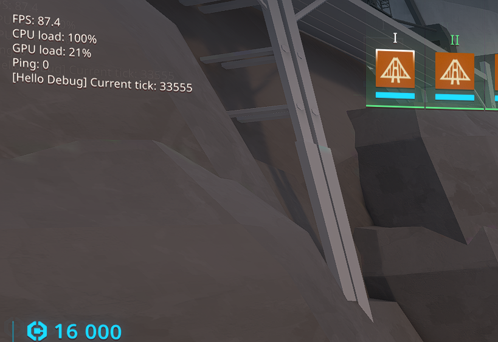

Такой вариант удобен, когда нужно быстро проверить:

- вызывается ли обработчик
- меняется ли значение от кадра к кадру
- какой сейчас у модуля внутренний статус

Если нужно не просто отладочное сообщение в краю экрана, а надпись в конкретной области, используйте [ImGui:DrawText](../api/ImGui.md#drawtext)

Например:

```lua
local function Tick()
    ImGui:DrawText(
        "[Hello Debug] Current tick: " .. tostring(Time.Tick),
        Rect(40, 240, 500, 40),
        16,
        Color(1, 1, 1, 1),
        TextAnchor.MiddleLeft
    )
end

Events:On("Tick", Tick)
```

Этот пример рисует обычную надпись в верхней левой части экрана.

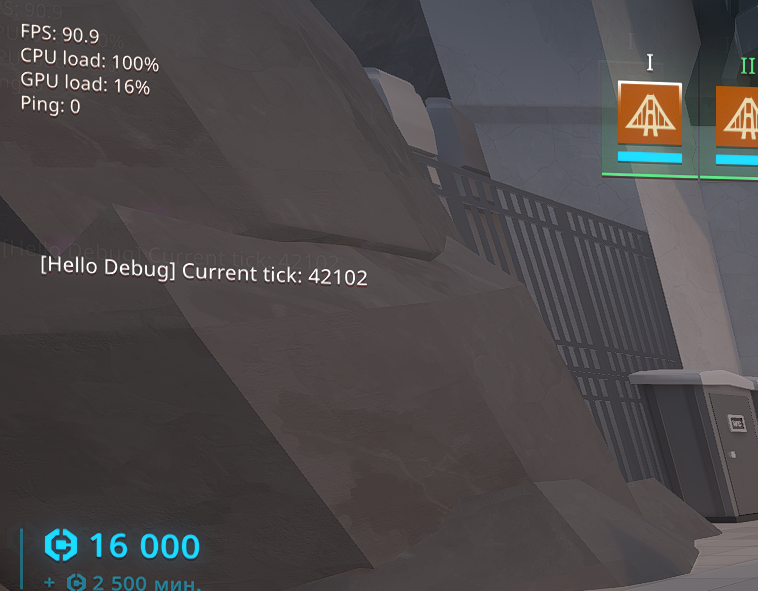

На практике разница простая:

- [`ImGui:DrawDebugText`](../api/ImGui.md#drawdebugtext) удобен для быстрой временной отладки
- [`ImGui:DrawText`](../api/ImGui.md#drawtext) удобен, когда вы хотите сами выбрать положение, размер и цвет текста

---

## 3. Клонируем и дополняем встроенный модуль

В этом разделе мы сделаем клон стандартного модуля миникарты и дополним его: добавим отображение координат игрока под миникартой рядом с названием текущей зоны.

### 3.1. Создаем клон встроенного модуля

Выбираем модуль из списка и нажимаем в нем кнопку "**Fork**".

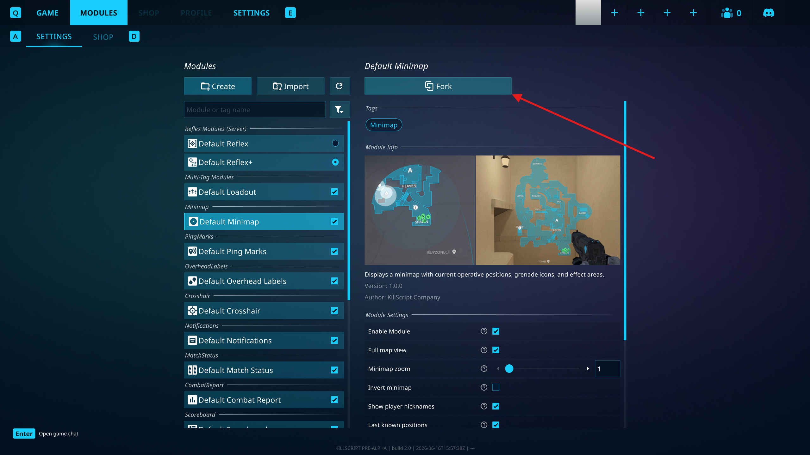

Далее нужно ввести название нового модуля и нажать "**Fork module**".

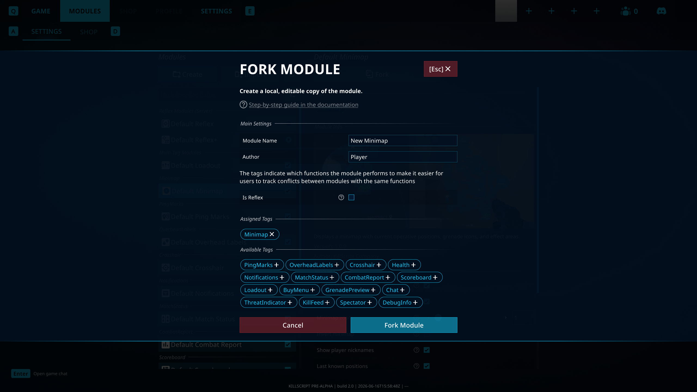

Это действие создаст новый пользовательский модуль, который склонирует всю структуру и ресурсы оригинального.

### 3.2. Устранение конфликта

Сейчас у нас есть два запущенных модуля, реализующих миникарту, поэтому старый нужно выключить, чтобы он нам не мешал.

Подробнее про кофликты и теги модуля: [Tech.md / Теги модуля](./5.Tech.md#module-tags)

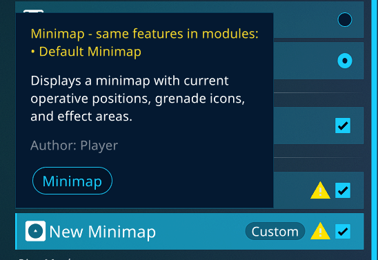

После отключения конфликт пропадает.

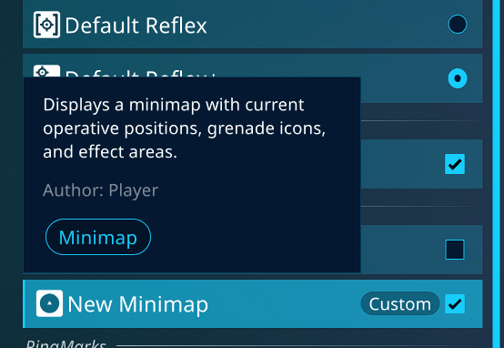

### 3.3. Запуск и проверка нового модуля

Запускаем игру и убеждаемся, что новый модуль миникарты работает корректно и перенял весь функционал своего исходника.

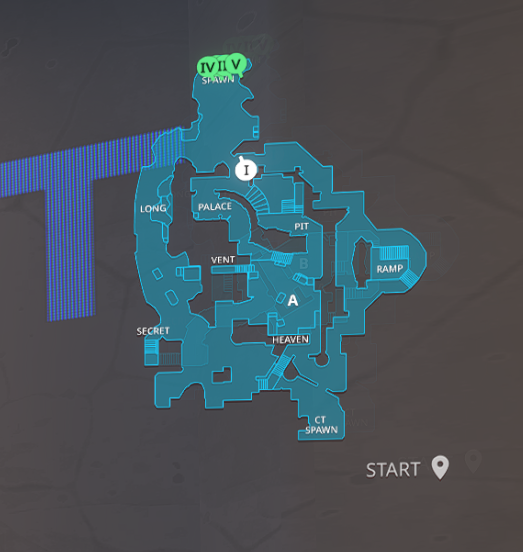

Но нам не нравится вывод зон под миникартой: мы хотим добавить к нему отображение координат. Давайте это изменим.

Этот путь нужно скопировать и открыть через VS Code.

### 3.4. Пошаговое редактирование

Теперь нам доступна папка с пользовательским модулем по пути:

```text
/[Папка с игрой]/Modules/[Название нового модуля]/
```

Открыть ее из игры можно через кнопку "**Folder**".

#### Шаг 1. Поиск функции

В файле `scripts/main.lua` функцию *UpdateZoneText()*, которая отвечает за вывод названия зоны под миникартой.

```lua
local function UpdateZoneText()
    local zones = MapInfo:GetZones(Cameras.Main.Position)
    local text = ''
    if zones.Length > 0 then
        text = zones[1]
    end

    text = UI:ToUpperInvariant(text)

    if coordinatesTextSmall then
        coordinatesTextSmall.text = text
    end

    if coordinatesTextFullscreen then
        coordinatesTextFullscreen.text = text
    end
end
```

Здесь идет получение списка зон в которых находится главная камера игрока из них берется первая зона и выводится.

#### Шаг 2. Изменение функции

Изменим функцию так, чтобы она выводила координаты игрока перед названием зоны.

```diff
local function UpdateZoneText()
    local zones = MapInfo:GetZones(Cameras.Main.Position)
    local text = ''
    if zones.Length > 0 then
        text = zones[1]
    end

-    text = UI:ToUpperInvariant(text)
+    local cord_text = 'Pos: ' .. tostring(LocalAgentPos) .. ' '
+    text = cord_text .. UI:ToUpperInvariant(text)

    if coordinatesTextSmall then
        coordinatesTextSmall.text = text
    end

    if coordinatesTextFullscreen then
        coordinatesTextFullscreen.text = text
    end
end
```

Теперь функция будет иметь такой вид:

```lua
local function UpdateZoneText()
    local zones = MapInfo:GetZones(Cameras.Main.Position)
    local text = ''
    if zones.Length > 0 then
        text = zones[1]
    end

    local cord_text = 'Pos: ' .. tostring(LocalAgentPos) .. ' '
    text = cord_text .. UI:ToUpperInvariant(text)

    if coordinatesTextSmall then
        coordinatesTextSmall.text = text
    end

    if coordinatesTextFullscreen then
        coordinatesTextFullscreen.text = text
    end
end
```

Сохраняем файл.

#### Шаг 3. Проверка новой миникарты

После входа в игру вы увидите, что миникарта изменилась.

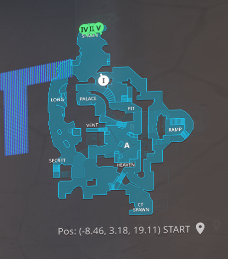

Радостно! 
