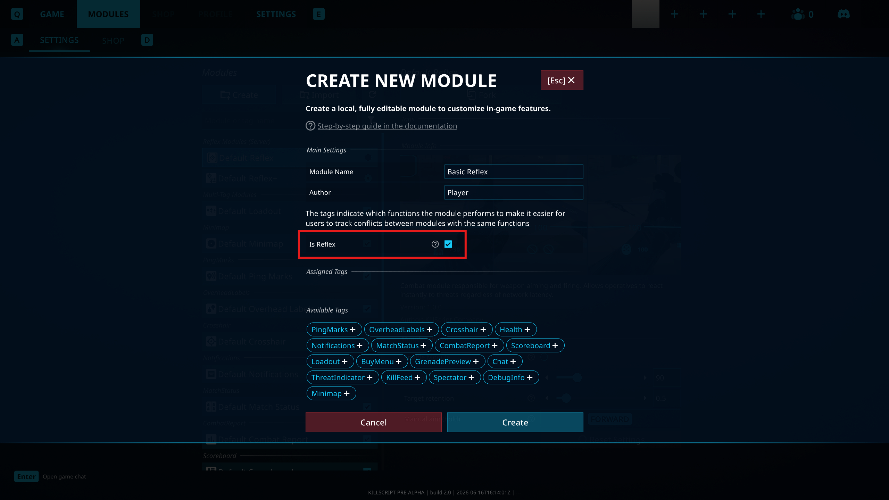

# Пишем свой Reflex-модуль

В этом разделе разбирается отдельный тип модулей с тегом `Reflex`, у которых есть и клиентская, и серверная Lua-логика.

## Оглавление

1. [Важные моменты](#1-важные-моменты)
2. [Что именно реализуем](#2-что-именно-реализуем)
3. [Пошаговая реализация](#3-пошаговая-реализация)

---

## 1. Важные моменты

Для аимбота мы будем использовать модуль с флагом `IsReflex`. Это особый тип модуля, который отличается от обычных.

У таких модулей есть две важные особенности. Во-первых, одновременно может быть включен только один модуль с тегом `Reflex`. Во-вторых, у него есть серверный файл `scripts/server.lua`.

Подробнее: [Tech.md / Флаг Reflex](./5.Tech.md#reflex-flag)

Выполнение аима на сервере полезно тем, что в перестрелках это уменьшает преимущество игроков с низким пингом. Кроме того, серверный код может получить предсказанные траектории выстрела и на их основе оценить вероятность попадания через `FirearmItem:GetPredictedHits()` ([Item.md](../api/Item.md#getpredictedhits)).

Когда игрок заходит на карту, игра берет код из `scripts/server.lua` и отправляет его на сервер.

Серверная часть не может отправлять на клиент произвольные данные. По сути, из доступного у нее есть только вывод в консоль через `print()` ([Print.md](../api/Print.md#print)), что особенно полезно для дебага.

Клиентский скрипт, в свою очередь, может передавать на сервер данные прямо в Lua-таблицах. Доступны для отправки:

- `string`
- `number`
- `table`

Для отправки данных на сервер в клиентской версии Reflex-модуля нужно заполнить таблицу `Network` ([Network.md](../api/Network.md#network)) и вызвать метод `NetworkProvider:SendBuffer()` ([Network.md](../api/Network.md#sendbuffer)).

После этого на серверной стороне данные также можно получить из таблицы `Network` ([Network.md](../api/Network.md#network)). Эти данные сохраняются и очищаются только при выключении модуля или при получении новых данных с клиента, потому что таблица полностью перезаписывается.

## 2. Что именно реализуем

Сделаем простой аимбот который на снайперском оружии и револьвере будет пытатстья попасть в голову с 80% вероятностью.
А на всех остальных будет пытаться попасть и в голову и в туловище с 50% вероятностью.

## 3. Пошаговая реализация

### 3.1. Создание модуля



Через меню модулей создадим новый и обязательно при создании зададим ему поле Is Reflex.

### 3.2. Простая наводка в голову и выстрел

Сначала сделаем самую базовую серверную часть. Она будет:

- искать ближайшую к прицелу видимую цель
- брать у нее хитбокс головы
- наводиться в центр этого хитбокса
- зажимать выстрел

Открываем `scripts/server.lua` и вставляем:

```lua
---@type Agent | nil
local LocalAgent = nil

local HALF_FOV_COS = math.cos(12 * math.pi / 180)

local function IsAgentAlive(agent)
    return agent and agent.Health and agent.Health.IsAlive == true
end

local function GetAimDot(target, firePos)
    local toTarget = (target.Aim.Position - firePos).normalized
    return Vector3.Dot(LocalAgent.Aim.Direction, toTarget)
end

local function FindHitboxByBodyPart(target, bodyPart)
    local hitboxes = target:GetHitboxes()

    for i = 0, hitboxes.Length - 1 do
        local hitbox = hitboxes[i]
        if hitbox and hitbox.BodyPart == bodyPart then
            return hitbox
        end
    end

    return nil
end

local function FindBestTarget(firePos)
    local enemies = Agents:GetEnemies()
    local bestTarget = nil
    local bestDot = HALF_FOV_COS

    for i = 0, enemies.Length - 1 do
        local enemy = enemies[i]
        if IsAgentAlive(enemy) and enemy.IsVisible then
            local dot = GetAimDot(enemy, firePos)
            if dot > bestDot then
                bestDot = dot
                bestTarget = enemy
            end
        end
    end

    return bestTarget
end

local function Tick()
    LocalAgent = Agents:GetLocalAgent()
    if not IsAgentAlive(LocalAgent) then
        return
    end

    local currentItem = LocalAgent.Inventory.CurrentItem
    if not currentItem or not currentItem.IsFirearm then
        LocalAgent.Aim:ResetAimTarget()
        return
    end

    local firearm = currentItem.AsFirearmItem
    local firePos = LocalAgent.Aim.Position
    local target = FindBestTarget(firePos)

    if not target then
        LocalAgent.Aim:ResetAimTarget()
        return
    end

    local headHitbox = FindHitboxByBodyPart(target, EHitboxBodyPart.Head)
    if not headHitbox then
        LocalAgent.Aim:ResetAimTarget()
        return
    end

    LocalAgent.Aim:SetAimTarget(headHitbox.Position, target)

    if firearm.HasAmmo and not firearm.IsReloading then
        AgentInput:SetButtonState(EInputButton.Fire, true)
    end
end

Events:On("Tick", Tick)
```

Этот вариант специально очень простой. Мы пока не добавляем сложные проверки точности, а просто строим понятную основу: нашлись враг и хитбокс головы, значит наводимся и стреляем.

### 3.3. Выбор режима по оружию и отправка `SniperMode`

Теперь разделим оружие на два режима:

- `SniperMode = true` для `SniperRifle` и `Revolver`, чтобы стрелять в голову
- `SniperMode = false` для всего остального, чтобы стрелять в туловище

Для этого добавим клиентский файл `scripts/main.lua`, который будет определять режим по текущему оружию и отправлять его на сервер:

```lua
---@type FirearmItem | nil
local CurrentFirearm = nil

local function IsAgentAlive(agent)
    return agent and agent.Health and agent.Health.IsAlive == true
end

local function GetWeaponName(firearm)
    return string.gsub(firearm.Name, " ", "")
end

local function GetDefaultSniperMode(weaponName)
    return weaponName == "SniperRifle" or weaponName == "Revolver"
end

local function LoadSniperModeForWeapon()
    if not CurrentFirearm then
        return
    end

    local weaponName = GetWeaponName(CurrentFirearm)
    Network.SniperMode = GetDefaultSniperMode(weaponName)
    NetworkProvider:SendBuffer()
end

local function CheckFirearmChanged()
    local localAgent = Agents:GetLocalAgent()
    if not localAgent then
        CurrentFirearm = nil
        return false
    end

    local currentItem = localAgent.Inventory.CurrentItem

    if currentItem and currentItem.IsFirearm then
        local firearm = currentItem.AsFirearmItem

        if not CurrentFirearm or firearm.Name ~= CurrentFirearm.Name then
            CurrentFirearm = firearm
            return true
        end
    else
        if CurrentFirearm then
            CurrentFirearm = nil
            return true
        end
    end

    return false
end

local function Tick()
    local localAgent = Agents:GetLocalAgent()
    if not IsAgentAlive(localAgent) then
        return
    end

    if CheckFirearmChanged() and CurrentFirearm then
        LoadSniperModeForWeapon()
    end
end

Network.SniperMode = false
Events:On("Tick", Tick)
```

После этого обновим `scripts/server.lua`, чтобы он смотрел не только в голову. Когда `SniperMode = true`, целимся в голову. Иначе целимся в туловище:

```lua
local function GetAimHitbox(target)
    if Network.SniperMode then
        return FindHitboxByBodyPart(target, EHitboxBodyPart.Head)
    end

    return FindHitboxByBodyPart(target, EHitboxBodyPart.Body)
        or FindHitboxByBodyPart(target, EHitboxBodyPart.Head)
end
```

И внутри обработчика `Tick` заменяем поиск хитбокса головы на:

```lua
local hitbox = GetAimHitbox(target)
if not hitbox then
    LocalAgent.Aim:ResetAimTarget()
    return
end

LocalAgent.Aim:SetAimTarget(hitbox.Position, target)
```

Теперь режим стрельбы определяется автоматически по оружию, а сервер читает это значение из `Network`.

### 3.4. Ручное переключение режима и сохранение через `Storage`

Автоматический выбор удобен как значение по умолчанию, но игроку лучше дать возможность поменять режим самому.

Для начала создадим файл `inputs.json`, чтобы повесить кнопку переключения:

```json
{
  "Actions": [
    {
      "Name": "ToggleSniperMode",
      "Type": "Button",
      "Binding": {
        "Path": "<Keyboard>/v"
      }
    }
  ]
}
```

Теперь обновим `scripts/main.lua`. Логика будет такая:

- при смене оружия пробуем загрузить сохраненное значение из `Storage`
- если сохранения нет, берем режим по умолчанию из шага 3
- по нажатию клавиши меняем режим, сохраняем его и снова отправляем на сервер

```lua
---@type FirearmItem | nil
local CurrentFirearm = nil

local ToggleSniperModeAction = nil

local function IsAgentAlive(agent)
    return agent and agent.Health and agent.Health.IsAlive == true
end

local function GetWeaponName(firearm)
    return string.gsub(firearm.Name, " ", "")
end

local function GetDefaultSniperMode(weaponName)
    return weaponName == "SniperRifle" or weaponName == "Revolver"
end

local function SaveSniperModeForWeapon()
    if not CurrentFirearm then
        return
    end

    if not Storage.Weapons then
        Storage.Weapons = {}
    end

    local weaponName = GetWeaponName(CurrentFirearm)
    Storage.Weapons[weaponName] = {
        SniperMode = Network.SniperMode
    }

    StorageProvider:SaveStorageTable()
end

local function LoadSniperModeForWeapon()
    if not CurrentFirearm then
        return
    end

    local weaponName = GetWeaponName(CurrentFirearm)

    if Storage.Weapons
        and Storage.Weapons[weaponName]
        and Storage.Weapons[weaponName].SniperMode ~= nil then
        Network.SniperMode = Storage.Weapons[weaponName].SniperMode
    else
        Network.SniperMode = GetDefaultSniperMode(weaponName)
    end

    NetworkProvider:SendBuffer()
end

local function ToggleSniperMode()
    if not CurrentFirearm then
        return
    end

    Network.SniperMode = not Network.SniperMode
    SaveSniperModeForWeapon()
    NetworkProvider:SendBuffer()
end

local function CheckFirearmChanged()
    local localAgent = Agents:GetLocalAgent()
    if not localAgent then
        CurrentFirearm = nil
        return false
    end

    local currentItem = localAgent.Inventory.CurrentItem

    if currentItem and currentItem.IsFirearm then
        local firearm = currentItem.AsFirearmItem

        if not CurrentFirearm or firearm.Name ~= CurrentFirearm.Name then
            CurrentFirearm = firearm
            return true
        end
    else
        if CurrentFirearm then
            CurrentFirearm = nil
            return true
        end
    end

    return false
end

local function Tick()
    local localAgent = Agents:GetLocalAgent()
    if not IsAgentAlive(localAgent) then
        return
    end

    if CheckFirearmChanged() and CurrentFirearm then
        LoadSniperModeForWeapon()
    end
end

Network.SniperMode = false

StorageProvider:LoadStorageTable()

ToggleSniperModeAction = InputActions:FindAction("ToggleSniperMode")
ToggleSniperModeAction:OnPerformed(ToggleSniperMode)
Events:On("Tick", Tick)
```

По сути, мы повторили ту же идею, что и в `Default Reflex+`: сохраняем настройки отдельно для каждого оружия, а потом подгружаем их при переключении.

### 3.5. Простой вывод текущего режима через `ImGui`

Осталось показать игроку, какой режим активен прямо сейчас. Никаких окон делать не будем, просто выведем текст внизу экрана.

Добавим в `scripts/main.lua` функцию:

```lua
local function DrawSniperMode()
    if not CurrentFirearm then
        return
    end

    local text = "Sniper: off"
    if Network.SniperMode then
        text = "Sniper: on"
    end

    ImGui:DrawText(
        text,
        Rect((Screen.Width * 0.5) - 100, Screen.Height - 80, 200, 30),
        20,
        Color(1.0, 1.0, 1.0, 1.0),
        TextAnchor.MiddleCenter)
end
```

И вызываем ее в обработчике `Tick` после обновления режима:

```lua
local function Tick()
    local localAgent = Agents:GetLocalAgent()
    if not IsAgentAlive(localAgent) then
        return
    end

    if CheckFirearmChanged() and CurrentFirearm then
        LoadSniperModeForWeapon()
    end

    DrawSniperMode()
end

Events:On("Tick", Tick)
```

На этом базовый Reflex-модуль готов. Готовые файлы примера лежат здесь: [Basic Reflex](../../modules/Basic%20Reflex/)
